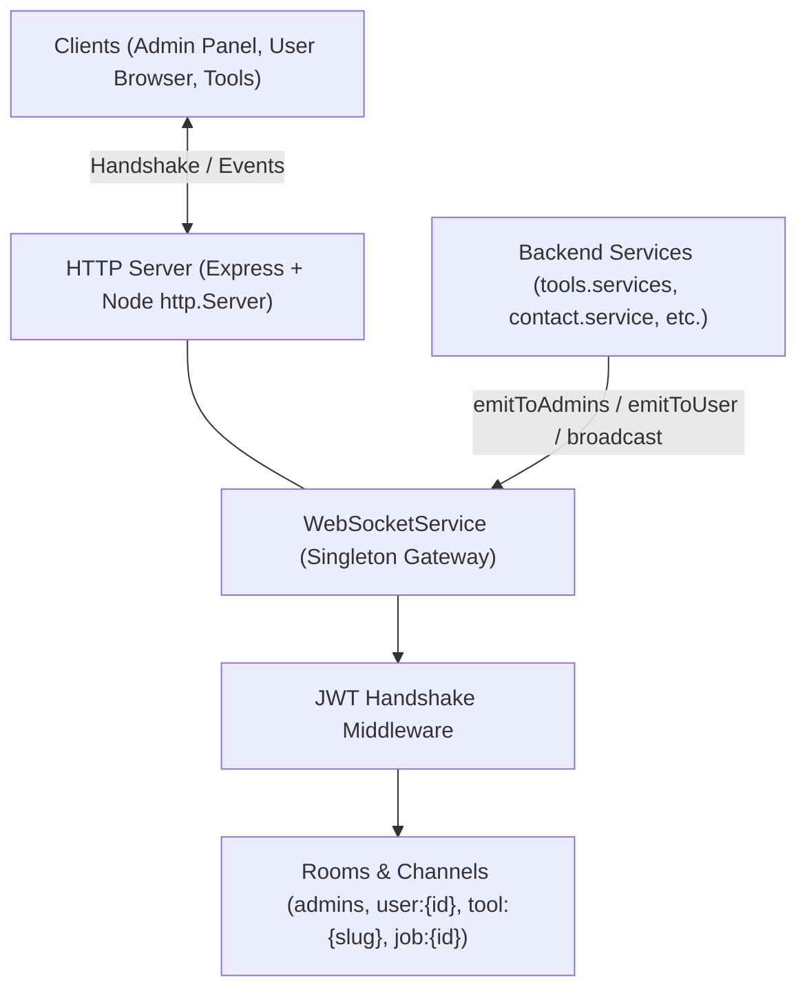

# WebSocket Real-Time Event System (web-tools-backend-new)

A robust, type-safe, decoupled, and horizontally scalable real-time WebSocket architecture built with **Socket.IO**.

---

## 🏗️ Architecture Overview



### Key Highlights
1. **Decoupled Singleton Architecture**: Controllers and services do not handle raw socket connections. They call simple methods on `WebSocketService.getInstance()`.
2. **Type Safety**: All event names, payloads, and rooms are declared in [`src/interfaces/websocket.interface.ts`](file:///f:/Aditya/Fusiontools/web-tools-backend-new/src/interfaces/websocket.interface.ts).
3. **Automatic Room Management & Security**:
   - Authenticated users automatically join `user:${userId}`.
   - Admin users (`role: "admin"` or `member_role: "admin"`) automatically join the protected `admins` room.
   - Anonymous visitors join the `public` room (useful for tool-specific progress updates without requiring login).
   - Unauthorized clients are blocked from joining protected rooms (`admins`, other users' private rooms).
4. **Resilient Fallback**: Automatically negotiates pure WebSockets with fallback to HTTP long-polling when client firewalls restrict WS.
5. **Horizontal Scaling Ready**: Ready to plug into `@socket.io/redis-adapter` for multi-instance load-balanced production clusters.

---

## 📡 Emitter API Reference

Anywhere in your backend (`services`, `controllers`, cron tasks, workers), import `WebSocketService` and emit typed events:

```typescript
import WebSocketService from "./services/websocket.service";
import { WebSocketEvents, WebSocketRooms } from "./interfaces/websocket.interface";
```

### 1. Emit to All Connected Administrators
Ideal for new user feedback, contact submissions, system errors, or KPI alerts:
```typescript
WebSocketService.getInstance().emitToAdmins(
  WebSocketEvents.TOOL_FEEDBACK_CREATED,
  feedbackData
);
```

### 2. Emit to a Specific User
Emits across all open browser tabs and devices belonging to a particular user:
```typescript
WebSocketService.getInstance().emitToUser(
  userId,
  WebSocketEvents.NOTIFICATION_NEW,
  {
    title: "Export Ready",
    message: "Your bulk keyword export has completed.",
    link: "/admin/tools/export",
    createdAt: new Date().toISOString()
  }
);
```

### 3. Emit to Multiple Specific Users
```typescript
WebSocketService.getInstance().emitToUsers([1, 4, 12], WebSocketEvents.NOTIFICATION_NEW, payload);
```

### 4. Broadcast to Everyone Connected
Ideal for site-wide maintenance banners or global announcements:
```typescript
WebSocketService.getInstance().broadcast(WebSocketEvents.SYSTEM_ALERT, {
  level: "warning",
  title: "Scheduled Maintenance",
  message: "Tool servers will restart in 10 minutes.",
  timestamp: new Date().toISOString()
});
```

### 5. Emit to a Custom Room / Channel
Ideal for tool channels, job progression, or team rooms:
```typescript
// Background job progress (e.g. PDF conversion, image compression)
const jobRoom = WebSocketRooms.job("job-abc-123");
WebSocketService.getInstance().emitToRoom(jobRoom, WebSocketEvents.JOB_PROGRESS, {
  jobId: "job-abc-123",
  jobType: "pdf-compress",
  progress: 75,
  status: "running"
});
```

---

## 📋 Adding a New Real-Time Event in 2 Steps

### Step 1: Add Event Name & Payload Contract
In [`src/interfaces/websocket.interface.ts`](file:///f:/Aditya/Fusiontools/web-tools-backend-new/src/interfaces/websocket.interface.ts):

```typescript
export enum WebSocketEvents {
  // Add your new event here:
  PAYMENT_SUCCESS = "payment:success",
}

// Add the payload type contract:
export interface PaymentSuccessPayload {
  orderId: string;
  amount: number;
  currency: string;
}
```

### Step 2: Trigger from Your Controller / Service
In your service (e.g. payment service or webhook handler):

```typescript
WebSocketService.getInstance().emitToUser(
  order.userId,
  WebSocketEvents.PAYMENT_SUCCESS,
  {
    orderId: order.id,
    amount: order.amount,
    currency: "USD"
  }
);
```

---

## 💻 Frontend Client Connection Guide (React / Next.js)

To connect from `web-tools-frontend`:

### Install Client
```bash
npm install socket.io-client --prefix web-tools-frontend
```

### Usage Example Hook
```typescript
import { useEffect, useState } from "react";
import { io, Socket } from "socket.io-client";

let socket: Socket | null = null;

export const useAdminWebSocket = (token?: string) => {
  const [connected, setConnected] = useState(false);

  useEffect(() => {
    const backendUrl = process.env.NEXT_PUBLIC_API_URL || "http://localhost:8000";

    socket = io(backendUrl, {
      path: "/socket.io",
      auth: { token },
      withCredentials: true,
      transports: ["websocket", "polling"]
    });

    socket.on("connect", () => {
      setConnected(true);
      console.log("🟢 Connected to WebSocket server:", socket?.id);
    });

    socket.on("tool:feedback_created", (feedback) => {
      console.log("⭐ Real-time feedback received:", feedback);
      // Update UI or show notification toast
    });

    socket.on("contact:message_received", (msg) => {
      console.log("📬 New contact message received:", msg);
      // Update badge count or notification drawer
    });

    socket.on("disconnect", (reason) => {
      setConnected(false);
      console.log("🔴 Disconnected:", reason);
    });

    return () => {
      socket?.disconnect();
    };
  }, [token]);

  return { connected, socket };
};
```

---

## 🚀 Horizontal Scaling (Redis Pub/Sub Multi-Instance)

When you deploy multiple backend instances behind a load balancer (AWS ECS, Kubernetes, GCP Cloud Run), add the Redis adapter:

1. `npm install @socket.io/redis-adapter redis`
2. In `src/services/websocket.service.ts`:
```typescript
import { createAdapter } from "@socket.io/redis-adapter";
import { createClient } from "redis";

const pubClient = createClient({ url: process.env.REDIS_URL });
const subClient = pubClient.duplicate();

await Promise.all([pubClient.connect(), subClient.connect()]);
this.io.adapter(createAdapter(pubClient, subClient));
```
Events emitted from any server instance will seamlessly route across all instances to the designated user or room.

